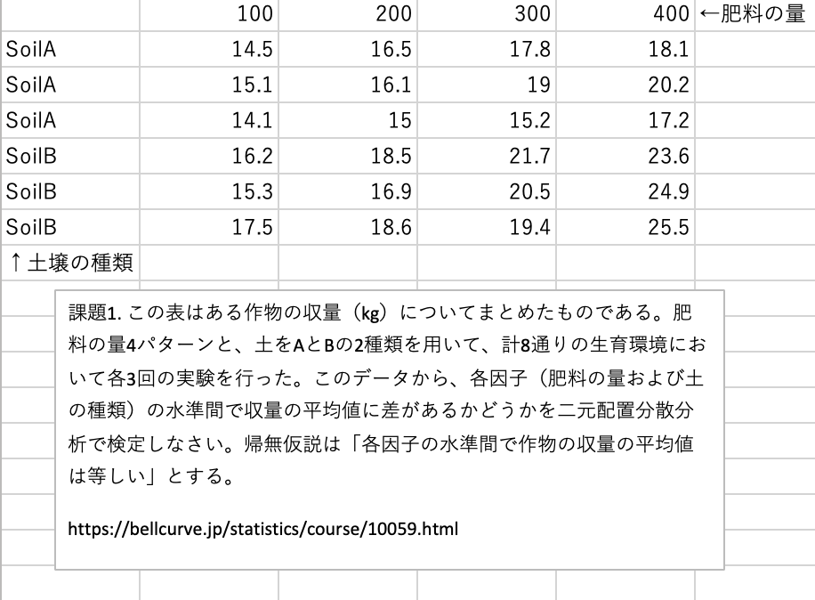
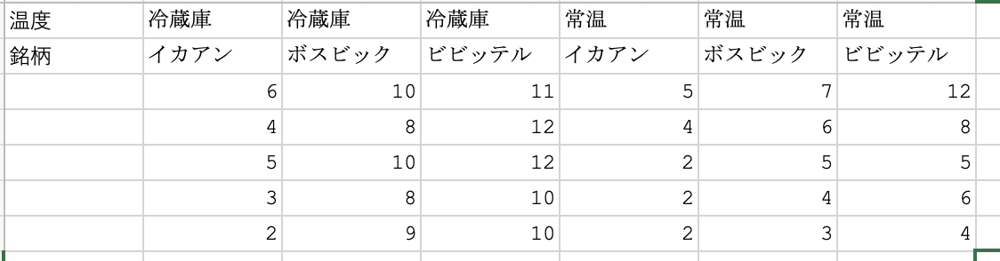
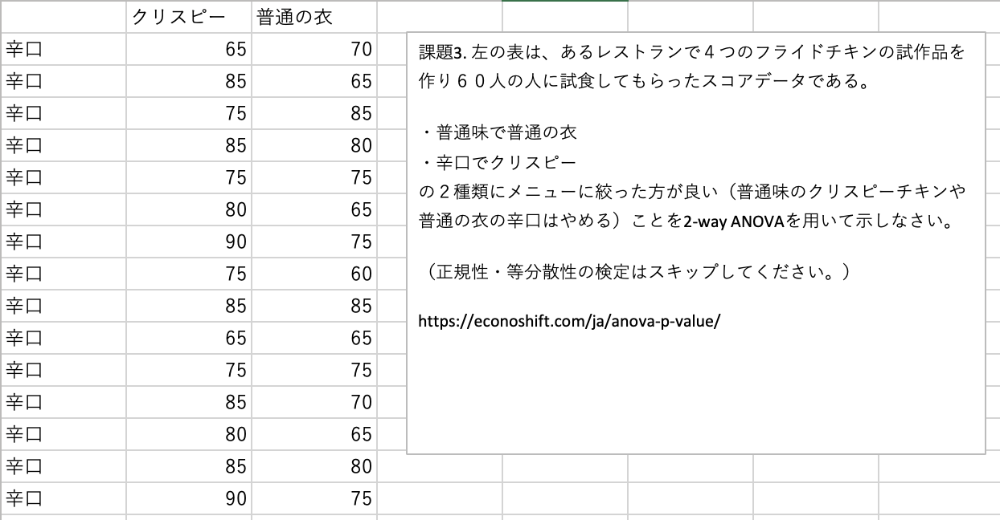
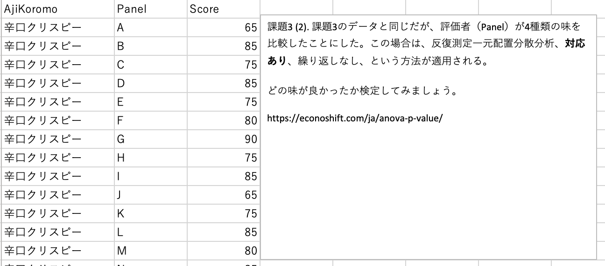

```{r setup, include=FALSE}
knitr::opts_chunk$set(echo = TRUE)
```

## 課題1
この表はある作物の収量（kg）についてまとめたものである（kadai123.xlsxも参照）。肥料の量4パターンと、土をAとBの2種類を用いて、計8通りの生育環境において各3回の実験を行った。このデータから、各因子（肥料の量および土の種類）の水準間で収量の平均値に差があるかどうかを二元配置分散分析で検定しなさい。帰無仮説は「各因子の水準間で作物の収量の平均値は等しい」とする。




### データを読み込む

```{r}
kadai1 <- read.delim("kadai1.tsv", stringsAsFactors=TRUE)
summary(kadai1)
```

### 正規性（正規分布であるか？）と等分散性の検定

課題では必須としないが例として紹介する。

```{r}
# コルモゴロフ・スミルノフ検定
require(nortest)
tapply(kadai1$Yield,kadai1$Soil,lillie.test)
tapply(kadai1$Yield,kadai1$Fertilizer,lillie.test)
# バートレット検定
bartlett.test(kadai1$Yield~kadai1$Soil)
bartlett.test(kadai1$Yield~kadai1$Fertilizer)
```

正規性の検定・等分散性の検定ともにp>0.05なので正規分布・等分散の条件を満たす。

### 二元配置分散分析
繰り返しありの二元配置分散分析

- 土壌（要因A）の主効果
  - 帰無仮説H0: 土壌の効果がない　（FA<F(dfA,dfR,α)）
  - 対立仮説H1: 土壌の効果がある　（FA≥F(dfA,dfR,α)）

- 肥料（要因B）の主効果
  - 帰無仮説H0: 肥料の効果がない（FB<F(dfB,dfR,α)）
  - 対立仮説H1: 肥料の効果がある（FB≥F(dfB,dfR,α)）

- 交互作用
  - 帰無仮説H0: 土壌と肥料の効果に交互作用がない（FA×B<F(dfA×B,dfR,α)）
  - 対立仮説H1: 交互作用がある（FA×B ≥ F(dfA×B,dfR,α)）

<font color="red">このコードを仕上げて！</font>
```{r}
# 2元配置分散分析、反復ありのANOVAのコードをここに書く
#summary(aov(y~x1*x2,data=kadai1)) # y, x1, x2を適宜書き換える

```

<font color="Red">
主因子の効果の解釈を書く<br>
交互作用があったかを書く<br>
</font>

### 多重比較
交互作用が有意となったので、試験区を「展開して」多重比較を行う。

まず、SoilとFertilizerをつなげ、すべての試験区を区別できる新しい因子SoilFertを作る。

```{r}
kadai1$SoilFert <- as.factor(paste(kadai1$Soil,kadai1$Fertilizer,sep=""))
summary(kadai1)
```
```{r}
boxplot(kadai1$Yield~kadai1$SoilFert)
```

なんとなく傾向がわかった。
<br>
念のため一元配置分散分析を行っておく。有意になるはず。

```{r}
summary(aov(kadai1$Yield~kadai1$SoilFert))
```

多重比較にはTukey-Kramer法を`multcomp`ライブラリーで行った。

（wariningがでると思いますが良しとします。）

```{r}
library(multcomp)
result1 <- aov(Yield~SoilFert,data=kadai1) # 分散分析の結果をresult1に格納
summary(result1) # 結果を表示する
result2 <- glht(result1, linfct = mcp(SoilFert = "Tukey")) # Tukey-Kramerの結果をresult2に格納
summary(result2) # 結果を表示する
cld(result2) # compact letter displayで多重比較の結果を表示
```

Compact letter displayをつけてグラフを描く。

```{r}
par()$mar # 上が切れるのでマージンを確認（私の場合は5.1 4.1 4.1 2.1）
par(mar=c(5.1, 4.1, 6, 2.1)) # 上のマージンを広げる
plot(cld(result2)) # compact letter displayつきの箱ひげ図を描く
```

<span style="color: red;">（異なる文字のグループの間では5%水準で有意な差があることを示す。）</span>

<font color="Red">
結論：ANOVAの結果とあわせて書く
<br>
</font>

（課題1はここまで）

## 課題2
下の表はミネラルウォーターの美味しさの評定に関する実験データである。
温度・銘柄および両者の交互作用がおいしさに影響を与えたかを2-way ANOVAにより検定しなさい。



評価した人はランダムであるとする（実際にはそうならない（つまり対応がある）場合も多いことに注意）。

### データ読み込み

データファイルに日本語を含むので`fileEncoding = "utf8"`を追加した。

```{r}
kadai2 <- read.delim("kadai2.tsv", stringsAsFactors=TRUE,fileEncoding = "utf8")
summary(kadai2)
```
### 正規性、等分散性の検定

省略

### 二元配置分散分析
繰り返しありの二元配置分散分析

- 温度（要因A）の主効果
  - 帰無仮説H0: 温度の効果がない　（FA<F(dfA,dfR,α)）
  - 対立仮説H1: 温度の効果がある　（FA≥F(dfA,dfR,α)）

- 銘柄（要因B）の主効果
  - 帰無仮説H0: 銘柄の効果がない（FB<F(dfB,dfR,α)）
  - 対立仮説H1: 銘柄の効果がある（FB≥F(dfB,dfR,α)）

- 交互作用
  - 帰無仮説H0: 温度と銘柄の効果に交互作用がない（FA×B<F(dfA×B,dfR,α)）
  - 対立仮説H1: 交互作用がある（FA×B ≥ F(dfA×B,dfR,α)）

<font color="red">このコードを仕上げて！</font>
```{r}
# ANOVAのコードをここに書く
#summary(aov(y~x1*x2,data=kadai2))# y, x1, x2を適宜書き換える
```

<font color="Red">
有意かどうかを確認して下さい。<br>
主因子：<br>
交互作用：<br>
</font>

### 多重比較
交互作用がないので、主因子のそれぞれについて比較を行う。

まずは温度にについて。

```{r}
library(multcomp)
result1 <- aov(Score~Ondo,data=kadai2) # 分散分析の結果をresult1に格納
summary(result1) # 結果を表示する
result2 <- glht(result1, linfct = mcp(Ondo = "Tukey")) # Tukey-Kramerの結果をresult2に格納
summary(result2) # 結果を表示する
cld(result2) # compact letter displayで多重比較の結果を表示
par()$mar # 上が切れるのでマージンを確認（私の場合は5.1 4.1 4.1 2.1）
par(mar=c(5.1, 4.1, 6, 2.1)) # 上のマージンを広げる
# 以下のどちらかの行の#を消してチャレンジ 今はMacむけ
# Mac
par(family = "HiraKakuProN-W6") #グラフで日本語を使うおまじないMac
# Windows
#par(family = "Meiryo") #グラフで日本語を使うおまじないWindows

plot(cld(result2)) # compact letter displayつきの箱ひげ図を描く
```

<span style="color: red;">（異なる文字のグループの間では5%水準で有意な差があることを示す。）</span>

<font color="Red">
解釈をここに書いてください。
</font>

つぎは銘柄について。

```{r}
library(multcomp)
result1 <- aov(Score~Meigara,data=kadai2) # 分散分析の結果をresult1に格納
summary(result1) # 結果を表示する
result2 <- glht(result1, linfct = mcp(Meigara = "Tukey")) # Tukey-Kramerの結果をresult2に格納
summary(result2) # 結果を表示する
cld(result2) # compact letter displayで多重比較の結果を表示
par()$mar # 上が切れるのでマージンを確認（私の場合は5.1 4.1 4.1 2.1）
par(mar=c(5.1, 4.1, 6, 2.1)) # 上のマージンを広げる
# 以下のどちらかの行の#を消してチャレンジ 今はMacむけ
# Mac
par(family = "HiraKakuProN-W6") #グラフで日本語を使うおまじないMac
# Windows
#par(family = "Meiryo") #グラフで日本語を使うおまじないWindows
plot(cld(result2)) # compact letter displayつきの箱ひげ図を描く
```

<span style="color: red;">（異なる文字のグループの間では5%水準で有意な差があることを示す。）</span>

<font color="Red">
解釈を書いてください。
<br></font>

<span style="color: red;">ビビッテル・ボスビック・イカアンの順にScoreが高いと言うのは良くない。ビビッテル・ボスビックの間には有意な差はないので注意深く言葉を選んでください。</span>

（課題2はここまで）


## 課題3
この表は、あるレストランで４つのフライドチキンの試作品を作り６０人の人に試食してもらったスコアデータである。

・普通味で普通の衣
・辛口でクリスピー
の２種類にメニューに絞った方が良い（普通味のクリスピーチキンや普通の衣の辛口はやめる）ことを2-way ANOVAを用いて示しなさい。



（正規性・等分散性の検定はスキップしてください。）

### データ読み込み
`stringsAsFactors=TRUE`をわすれないように。
データファイルに日本語を含むので`fileEncoding = "utf8"`を追加した。

```{r}
kadai3 <- read.delim("kadai3.tsv", stringsAsFactors=TRUE,fileEncoding = "utf8")
summary(kadai3)
```

### 分布の確認
Rcmdrの機能を用いた。文字化けする。普通味、辛口、クリスピー、普通味。バラバラに描くとあまり情報を得られない悪い例。
```{r, fig.width=5, fig.height=15}
require(Rcmdr)

with(kadai3, Hist(Score, groups=Aji, scale="frequency", breaks="Sturges", 
  col="darkgray"))
with(kadai3, Hist(Score, groups=Koromo, scale="frequency", breaks="Sturges", 
  col="darkgray"))
```

分布を見ても傾向はよくわからない。


### 二元配置分散分析
繰り返しありの二元配置分散分析

- 味（要因A）の主効果
  - 帰無仮説H0: 味の効果がない　（FA<F(dfA,dfR,α)）
  - 対立仮説H1: 味の効果がある　（FA≥F(dfA,dfR,α)）

- 衣（要因B）の主効果
  - 帰無仮説H0: 衣の効果がない（FB<F(dfB,dfR,α)）
  - 対立仮説H1: 衣の効果がある（FB≥F(dfB,dfR,α)）

- 交互作用
  - 帰無仮説H0: 味と衣の効果に交互作用がない（FA×B<F(dfA×B,dfR,α)）
  - 対立仮説H1: 交互作用がある（FA×B ≥ F(dfA×B,dfR,α)）


```{r}
summary(aov(Score~Aji*Koromo,data=kadai3))
```

主要因は有意にならなかったが、交互作用のみが有意となった（p<0.05）。

要因を「展開」してどの味・衣の組合せが異なるかを調べる。

### 多重比較（Tukey-Kramer）

まず、AjiとKoromoをつなげてすべての試験区を区別できる新しい因子AjiKoromoを追加する。

```{r}
kadai3$AjiKoromo <- as.factor(paste(kadai3$Aji,kadai3$Koromo,sep=""))
summary(kadai3)
```

多重比較にはTukey-Kramerを用いた。

```{r}
library(multcomp)
result1 <- aov(Score~AjiKoromo,data=kadai3) # 分散分析の結果をresult1に格納
summary(result1) # 結果を表示する
result2 <- glht(result1, linfct = mcp(AjiKoromo = "Tukey")) # Tukey-Kramerの結果をresult2に格納
summary(result2) # 結果を表示する
cld(result2) # compact letter displayで多重比較の結果を表示
par()$mar # 上が切れるのでマージンを確認（私の場合は5.1 4.1 4.1 2.1）
par(mar=c(5.1, 4.1, 6, 2.1)) # 上のマージンを広げる
# 以下のどちらかの行の#を消してチャレンジ 今はMacむけ
# Mac
par(family = "HiraKakuProN-W6") #グラフで日本語を使うおまじないMac
# Windows
#par(family = "Meiryo") #グラフで日本語を使うおまじないWindows
plot(cld(result2)) # compact letter displayつきの箱ひげ図を描く
```

<span style="color: red;">（異なる文字のグループの間では5%水準で有意な差があることを示す。）</span>

<font color="Red">
解釈を書く。つじつまがあえば自由に考えて良い。
<br>
</font>

## 課題3(2) （課題3よりもありえそうな例）

Repeated measures one-way ANOVA

この表は、あるレストランで４つのフライドチキンの試作品を作り**15人**の人に4種類を試食してもらったスコアデータである。

どの味衣（`AjiKoromo`）の組合せがベストかをANOVAを用いて示しなさい。



（正規性・等分散性の検定はスキップしてください。）

### データ読み込み
`stringsAsFactors=TRUE`をわすれないように。
データファイルに日本語を含むので`fileEncoding = "utf8"`を追加した。

```{r}
kadai3_2 <- read.delim("kadai3_2.tsv", stringsAsFactors=TRUE,fileEncoding = "utf8")
summary(kadai3_2)
```

### 分布の確認
（省略：課題3と同じ）

### 二元配置分散分析
繰り返し測定の一元配置分散分析

- AjiKoromo味衣（要因A）の主効果
  - 帰無仮説H0: AjiKoromoの効果がない　（FA<F(dfA,dfR,α)）
  - 対立仮説H1: AjiKoromoの効果がある　（FA≥F(dfA,dfR,α)）

- Panelパネル=評価者（要因B）の主効果
  - 帰無仮説H0: 評価者の効果がない（FB<F(dfB,dfR,α)）
  - 対立仮説H1: 評価者の効果がある（FB≥F(dfB,dfR,α)）

- 交互作用
検定できない

```{r}
summary(aov(Score~AjiKoromo+Panel,data=kadai3_2))
```

AjiKoromoはScoreと関連がある（p=0）。
PanelはScoreと関連がある（p=0）。

どの味・衣の組合せが異なるかを調べる。

### 多重比較（Tukey-Kramer）

多重比較にはTukey-Kramerを用いた。

```{r}
library(multcomp)
result1 <- aov(Score~AjiKoromo+Panel,data=kadai3_2) # 分散分析の結果をresult1に格納
summary(result1) # 結果を表示する
result2 <- glht(result1, linfct = mcp(AjiKoromo = "Tukey")) # Tukey-Kramerの結果をresult2に格納
summary(result2) # 結果を表示する
cld(result2) # compact letter displayで多重比較の結果を表示
par()$mar # 上が切れるのでマージンを確認（私の場合は5.1 4.1 4.1 2.1）
par(mar=c(5.1, 4.1, 6, 2.1)) # 上のマージンを広げる
# 以下のどちらかの行の#を消してチャレンジ 今はMacむけ
# Mac
par(family = "HiraKakuProN-W6") #グラフで日本語を使うおまじないMac
# Windows
#par(family = "Meiryo") #グラフで日本語を使うおまじないWindows
plot(cld(result2)) # compact letter displayつきの箱ひげ図を描く
```

<span style="color: red;">（異なる文字のグループの間では5%水準で有意な差があることを示す。）</span>

課題3とは結果が異なる。検定を方法を間違えると異なる結果を導く可能性がある。

解釈
<font color="Red">

解釈を書く。つじつまがあえば自由に考えて良い。
<br>
</font>