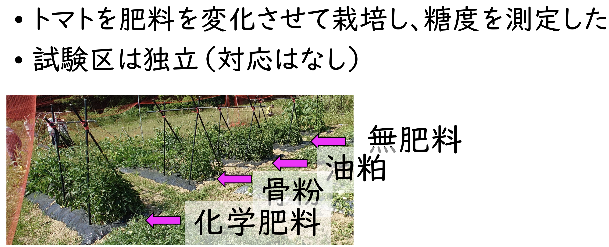

```{r setup, include=FALSE}
knitr::opts_chunk$set(echo = TRUE)
library(readxl)
```



## 練習1
#### データを読み込む
Excelファイル「トマト糖度.xlsx」を読み込む。<br>
読み込み先のデータフレーム名を`renshu`として以下のように読み込むことにした。

```{r}
renshu <- read_excel("トマト糖度.xlsx")
summary(renshu) # データフレームrenshu1を表示
```
<font color="red">
この形式のデータはRでは解析しづらい。試験区が独立な場合はスタック形式が良い。<br>
また、列名には日本語を用いると面倒。
</font>
<br><br>
スタック形式に変換したExecl形式を読み込む。<br>

```{r}
renshu <- read_xlsx("トマト糖度スタック形式.xlsx") # renshuを上書き
summary(renshu) # データフレームrenshuを表示
```

肥料の種類が`character`として認識されているので良くない。因子(`factor`)として認識されるよう修正する。

```{r}
renshu$Fertilizer<-as.factor(renshu$Fertilizer)
summary(renshu) # データフレームrenshuを表示
```
肥料の種類ごとにデータがカウントされていることを確認する。


#### グラフを描いてみる
```{r}
#### グラフを描いてみる
# boxplotを描いてみる
boxplot(renshu$BRIX~renshu$Fertilizer)
# boxplotの上にドットプロットを重ねて描く
stripchart(renshu$BRIX~renshu$Fertilizer, 
  vertical=TRUE, # 縦に
  method="jitter", # 近い点はランダムにずらす
  add=TRUE) # 前のグラフに追加（上書き）
```

差はありそうだがなんともいえない。

#### 分散分析を行うための前提条件を検討する

##### 正規性の検定
（各群のデータごとに行う。一種の多重検定になる。）

###### シャピロ・ウィルクの正規性の検定（Shapiro-Wilk test）
- 帰無仮説：正規分布している
  - （データの母集団は正規分布に従っている）
- 対立仮説：正規分布していない
  - （データの母集団は正規分布に従っていない）

帰無仮説が採択された場合→等分散性の検定へ

対立仮説が採択された場合→ノンパラメトリック検定へ

```{r}
# tapplyを使ってFertilizerの種類ごとにshapiro.test関数を実行する
tapply(renshu$BRIX,renshu$Fertilizer,shapiro.test)
```

<font color="red">
すべての試験区でp>0.05となり正規分布とみなして良いとわかった。
</font>

<font color="Red">
注：繰り返し検定（多重検定）になるのでp値をHolm補正したほうが良いとする考えもある。この授業では、シンプルに各グループに対して検定を行って、個別に判断することにする。
</font>


```{r}
# tapplyではわかりにくい場合こちらのコードでもOK
# R特有のわかりにくさですが
shapiro.test(renshu[renshu$Fertilizer=="NoFertilizer",2][[1]]) # 2は2列目を指す
shapiro.test(renshu[renshu$Fertilizer=="Chemical",2][[1]]) # 2は2列目を指す
shapiro.test(renshu[renshu$Fertilizer=="BonePowder",2][[1]]) # 2は2列目を指す
shapiro.test(renshu[renshu$Fertilizer=="OilCake",2][[1]]) # 2は2列目を指す
```

<font color="red">
上の方法と全く同じ結果になる。
</font>


###### コルモゴロフ・スミルノフ検定（Kolmogorov-Smirnov test）

Shapiro-Wilk testと同じように用いられる。

- 帰無仮説：正規分布している
 - （データの母集団は正規分布に従っている）
- 対立仮説：正規分布していない
 - （データの母集団は正規分布に従っていない）

ライブラリ`nortest`が必要。最初は
`install.packages("nortest")`
でインストールしておく。

```{r}
require(nortest)
tapply(renshu$BRIX,renshu$Fertilizer,lillie.test)
```

<font color="red">
Shapiro-Wilkと同じくすべてp>0.05なので帰無仮説は棄却されず、どのグループも正規分布とみなして良い。
</font>


##### 等分散性の検定（各群のデータごとに繰り返し行う）

等分散性の検定（3群以上）はバートレット検定（Bartlett test）を用いる。（2群のときはF検定（前回））

- 帰無仮説：各群の母分散は等しい（等分散）
- 対立仮説：各群の母分散に等しいとはいえない（不等分散）

帰無仮説が採択された場合→分散分析・多重比較へ

対立仮説が採択された場合→ノンパラメトリック検定へ・またはWelchの等分散を仮定しないANOVAヘ


```{r}
# グループごとの分散を表示
tapply(renshu$BRIX,renshu$Fertilizer,var)
# Bartlett testを実行
# data=renshuオプションを用いて表記を簡略化できる場合もある
bartlett.test(BRIX ~ Fertilizer, data=renshu)

```

<font color="red">
p>0.05となり帰無仮説は棄却されない。4つのグループは等分散とみなして良い。
</font>

<font color="Red">
**以上で、分散分析を行う前提がクリアされたので分散分析を行う。**
</font>


#### 一元配置分散分析

**分散分析は、3群以上のデータの平均に差があるか**を調べるための方法。

- 帰無仮説：各群の平均は等しい
- 対立仮説：各群の平均は等しいとはいえない

分散分析では、各群の”平均の分散”が、各群の群内の”分散の平均”よりも大きいかどうかを調べる。 誤差分散=（群内の分散の平均）という意味。<br>
（各群の平均の分散）＞（誤差分散）ならば平均に差がある、ということになる。


```{r}
# グループごとの平均を表示
tapply(renshu$BRIX,renshu$Fertilizer,mean)

# 分散分析を実行して結果をanova_resultに格納
anova_result<-aov(BRIX ~ Fertilizer, data=renshu)
# anova_resultの内容を人間に優しい表記（いわゆる分散分析表）で表示
summary(anova_result)
```

<font color="red">
p=0.0058 (<0.01)なので帰無仮説は1%水準で棄却された。4つの試験区の間には差があるとみなして良いことがわかった。</font>
<br><br>

#### 等分散を仮定しないWelchの分散分析
等分散を仮定しないWelchの分散分析を試す。こちらは`oneway.test()`関数を用いる。`var.equal=FALSE`を指定できる。

等分散を仮定しないt検定のANOVAバージョン。
`var.equal=TRUE`で上の（`aov()`）と同じ結果になる。

```{r}
# グループごとの平均を表示
tapply(renshu$BRIX,renshu$Fertilizer,mean)
# 分散分析を実行
oneway.test(BRIX ~ Fertilizer, data=renshu, var.equal=FALSE)
```

<font color="red">
p=0.0012 (<0.01)なので帰無仮説は1%水準で棄却され、4つの試験区の間には差があるとみなして良いと言える。
</font>

#### 多重比較

##### Tukey Kramer法による多重比較

以下のコマンドで総当たりt検定（Tukey-Kramer HSD検定）を行う。Tukey Kramer法、Bonferroni法、Holm法は、総当たり比較を行う方法。<br>

2群の比較よりも保守的になる。（有意になりにくくなる。）

```{r}
TukeyHSD(aov(BRIX~Fertilizer,data=renshu),"Fertilizer")
```

<font color="red">
ChemicalとNoFertilizerの間で平均が異なる（p=0.006）と言える。
</font>

##### Tukey-Kramer 別の方法

組み合わせが多くなると、有意に異なるグループを識別するのが難しくなる。平均が有意に異なるグループに異なるシンボル（a, b, c, ...）をつけてくれる機能を試してみる。

`install.packages("multcomp")`でライブラリ`multcomp`をインストールしておく。


```{r, results=FALSE}
library(multcomp)
```


まず、分散分析の結果を`anova_result`に格納する上記のコードを念のため再度実行する。

```{r}
# 分散分析を実行して結果をanova_resultに格納
anova_result<-aov(BRIX ~ Fertilizer, data=renshu)
# anova_resultの内容を人間に優しい表記（分散分析表）で表示
summary(anova_result)
```

次に、Tukey-Kramer法による多重比較の結果を`tukey_result`に格納する。

```{r}
# Tukey-Kramerの結果をtukey_resultに格納
tukey_result <- glht(anova_result, linfct = mcp(Fertilizer = "Tukey"))
summary(tukey_result) # 結果を表示する
```

`TukeyHSD`とp値が異なるが計算の誤差として無視することにする。

さらに、平均が有意に異なるグループに異なるシンボル（a, b, c, ...）（compact letter display, CLD）をつけてくれる関数を実行する。異なる文字を持つグループ間には5%水準で有意な差がある。**2つ以上の文字を持つグループができる可能性もある。**

```{r}
cld(tukey_result)
```

ChemicalとNoFertilizerは異なるが、そのほかの組合わせでは異なるとはいえない。

この結果を箱ひげ図に重ねてみる。

```{r}
plot(cld(tukey_result)) # CLD (abc)つきの箱ひげ図を描く
# boxplotの上にドットプロットを重ねて描く
stripchart(renshu$BRIX~renshu$Fertilizer, 
  vertical=TRUE, # 縦に
  method="jitter", # 近い点はランダムにずらす
  add=TRUE) # 前のグラフに追加（上書き）
```


##### Bonferroni法

以下のコマンドにより実行する。

```{r}
pairwise.t.test(renshu$BRIX,renshu$Fertilizer,p.adjust.method="bonferroni") # Bonferroniが小文字で始まることに注意
```

p値はTukey-Kramerよりも大きめになるようだ。

上記のTukeyと同様の命令を用いてCLDを付けることができる。`glht`関数内の`Fertilizer="Tukey"`は総当たり比較を行うことを指示するパラメーターで、glht関数の呼び方は上記のTukeyの場合と全く同じ。`summary`するときに`test = adjusted("bonferroni"))`を付けるとp値を補正してくれる。


```{r}
bonf_summary <- summary(glht(anova_result, linfct = mcp(Fertilizer = "Tukey")),test = adjusted("bonferroni"))
bonf_summary # 結果を確認
cld(bonf_summary) # CLDをつけてConsole出力
plot(cld(bonf_summary)) # CLD付きのグラフを出力
```


<font color="red">
Tukey-Kramerと同様になることがわかった。
</font>

##### Holm法
Bonferroni法による多重比較ととてもよく似た以下のコマンドにより実行する。

```{r}
pairwise.t.test(renshu$BRIX,renshu$Fertilizer,p.adjust.method="holm") # Holmが小文字で始まることに注意

# 再度、同様の命令を用いてCLDを付けることができる
holm_summary <- summary(glht(anova_result, linfct = mcp(Fertilizer = "Tukey")),test = adjusted("holm"))
holm_summary # 結果を確認
cld(holm_summary) # CLDをつけてConsole出力
plot(cld(holm_summary)) # CLD付きのグラフを出力
```

<font color="red">
Tukey-Kramer、Bonferroniと同様になることがわかった。p値はBonferroniよりも小さめになり、有意になりやすくなる。
</font>

<br>

##### Dunnettの多重比較

多重比較では、ひとつの参照（対照群）との比較を行う場合もあり、その場合はDunnettの方法がよく用いられる。総当たり比較よりも多重性が下がるので有意になりやすくなる。目的に応じて使い分ける。

NoFertilizerを対照区としてDunnettの多重比較を行う。<br>

対照区を指定するために`relevel`を用い、`relevel(renshu$Fertilizer, ref ="NoFertilizer")`として`NoFertilizer`を対照区に設定した。<br>


```{r}
require(multcomp)
# relevelを使って対照区をNoFertilizerに指定
renshu$Fertilizer <- relevel(renshu$Fertilizer, ref ="NoFertilizer")
# 分散分析を実行して結果をanova_resultに格納
anova_result<-aov(BRIX ~ Fertilizer, data=renshu)
# anova_resultの内容を人間に優しい表記（いわゆる分散分析表）で表示
summary(anova_result)
# Dunnettの結果をdunnett_resultに格納
dunnett_result <- glht(anova_result, linfct = mcp(Fertilizer = "Dunnett"))
summary(dunnett_result) # 結果を表示する
```


<font color="red">
この比較パターンでは、NoFertilizerと差があるのはChemical（p=0.003）とBonePowder（p=0.041）。
</font>

##### Dunnetの多重比較（AgroRパッケージを利用）

AgroRパッケージは高機能だがその一部を使ってみる。

```{r}
require(AgroR)
library(AgroR)
# Dunnettの多重比較を実行
dunnett_result2 <- with(renshu,dunnett(
  trat= Fertilizer,resp= BRIX,
  control = "NoFertilizer", # 対照群のレベル名
  alpha = 0.05
))
bar_dunnett(
  output.dunnett = dunnett_result2,
  ylab = "BRIX", # Y軸のラベル
  xlab = "Fertilizer",     # X軸のラベル
  add.mean = TRUE,        # 平均値をプロットに追加
  round = 2               # 平均値の表示桁数
)
```

